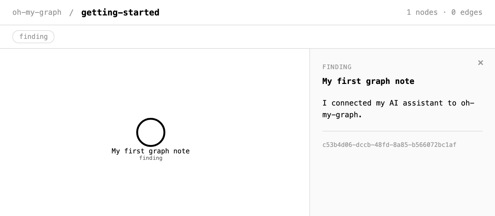
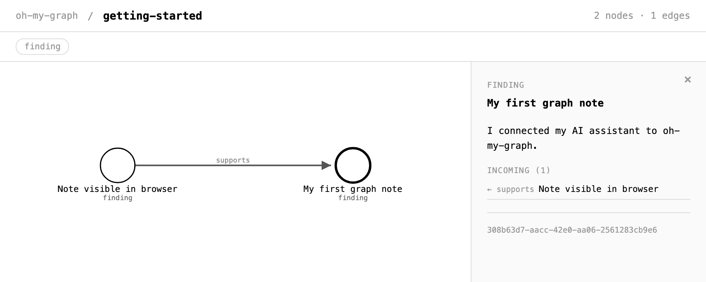

# oh-my-graph

oh-my-graph is an MCP server that lets AI assistants share project findings, decisions, and notes across sessions.


## Quick Start

1. **Install and start the server.**

   **macOS with Homebrew**

   ```sh
   brew install h0n9/devops/oh-my-graph
   brew services start h0n9/devops/oh-my-graph
   ```

   **Linux or macOS without Homebrew**

   ```sh
   curl -fsSL https://raw.githubusercontent.com/h0n9/oh-my-graph/main/install.sh | sh
   "$HOME/.local/bin/oh-my-graph"
   ```

   Leave this terminal running when using the installer. The server listens on all network interfaces by default. Restrict access for local use and [enable authentication](docs/setup.md#security-and-authentication) before exposing it.

2. **Connect your AI client.** Use `http://localhost:7780/mcp`. Pick your client for setup instructions.

   [Claude Desktop](docs/setup.md#claude-desktop) · [Claude Code](docs/setup.md#claude-code) · [Codex](docs/setup.md#codex)

3. **Save a note and find it in the graph.** Paste this into your AI client.

   > Use oh-my-graph to save a finding in topic `getting-started` with summary `My first graph note` and description `I connected my AI assistant to oh-my-graph.`

   Open [the graph](http://localhost:7780/), select `getting-started`, and click `My first graph note` to see its details.

   

4. **Link a second note (optional).** Paste this into your AI client.

   > In oh-my-graph, find the existing note `My first graph note` in topic `getting-started`. Add a finding in that topic with summary `Note visible in browser` and description `I opened getting-started and saw My first graph note in the graph.` Add a `supports` edge from the new finding to the existing note.

   Open [getting-started](http://localhost:7780/graph?topic=getting-started) and select `My first graph note`. Look for `Note visible in browser` under **Incoming**. The arrow points from the supporting observation to the note it supports.

   

## Guides

- [Deploy on Sprites](docs/setup.md#deploy-on-sprites) or [sync across Macs](docs/setup.md#syncing-across-devices).
- [Explore the graph and manage topics](docs/using-the-graph.md).
- [Look up MCP tools, data formats, and benchmarks](docs/reference.md).

## License

[Apache 2.0](LICENSE)
