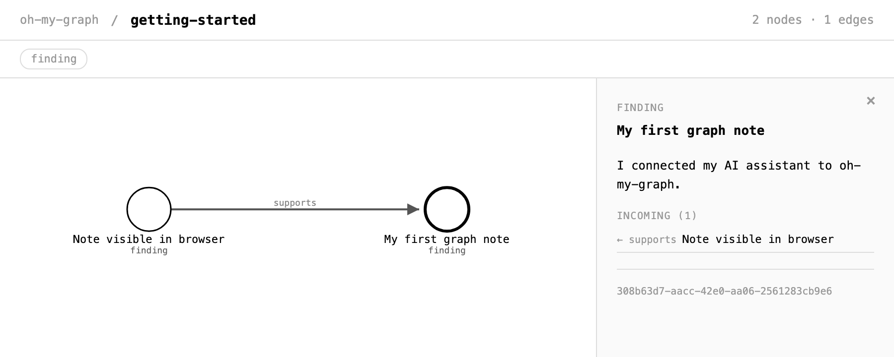

# Use the graph

[Back to Quick Start](../README.md#quick-start)

## Link two notes

1. After completing [Quick Start](../README.md#quick-start), paste this into your AI client.

   > In oh-my-graph, find the existing note `My first graph note` in topic `getting-started`. Add a finding in that topic with summary `Note visible in browser` and description `I opened getting-started and saw My first graph note in the graph.` Add a `supports` edge from the new finding to the existing note.

2. Open [getting-started](http://localhost:7780/graph?topic=getting-started) and select `My first graph note`. Look for `Note visible in browser` under **Incoming**. The arrow points from the supporting observation to the note it supports.

## Explore and manage topics

Open **`http://localhost:7780/`** in your browser to explore the graph visually — the topic list shows node/edge counts, and `/graph?topic=<name>` renders a live interactive force-directed graph. Selecting a node opens its details, including any tags stored on that node.

Use the **pencil icon** to rename a topic or the **archive box icon** to archive it. Archiving preserves the graph and reserves its name while hiding the topic from **Topics**. Open **Archived** and use the **restore arrow** to make a topic active again or the **trash icon** to permanently delete its graph data. After deletion, a new topic can use the same name.

## Continue work across assistants

1. **Capture an idea with ChatGPT Voice.** Save the problem, findings, and decisions to a project topic.
2. **Implement with Claude Code.** Ask it to read the topic and use the saved decisions to propose and implement the change.
3. **Prepare documentation with another assistant.** Ask it to read the same topic for the original goals and implementation details.

## Messaging

Agents communicate asynchronously via `message` nodes in a shared topic:

1. **Session A** writes a `message` node to topic `"comms"`
2. **Session B** polls `read_nodes_since_cursor("comms", cursor: last_cursor, types:["message"])` and sees the message
3. **Session B** replies with a new `message` node + `replies_to` edge pointing back

No extra infrastructure needed — the graph is the message bus.
